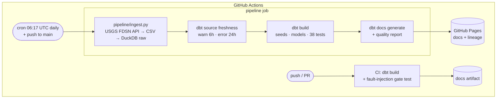
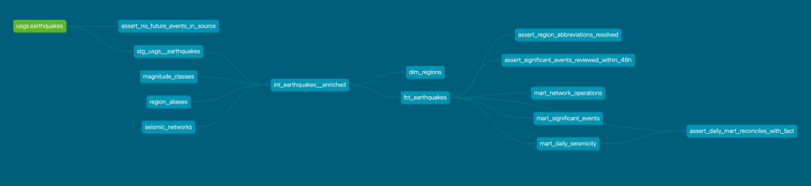
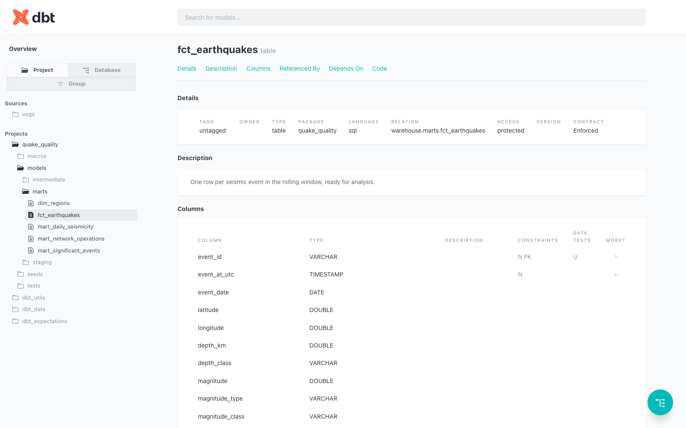
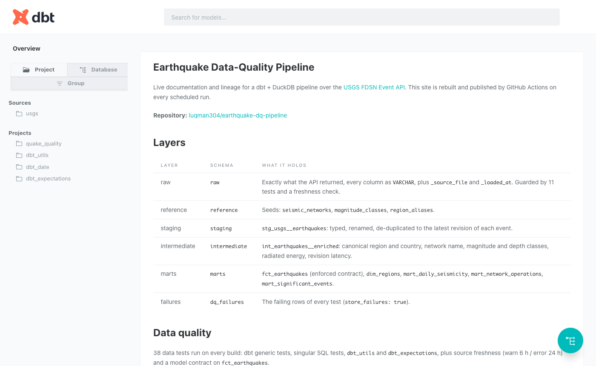
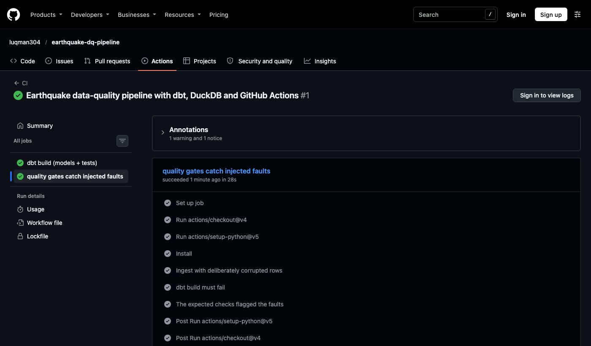

# Earthquake Data-Quality Pipeline

[](https://github.com/luqman304/earthquake-dq-pipeline/actions/workflows/ci.yml)
[](https://github.com/luqman304/earthquake-dq-pipeline/actions/workflows/pipeline.yml)
[](https://luqman304.github.io/earthquake-dq-pipeline/)

A small, production-style analytics pipeline that ingests **live earthquake data from the USGS**,
models it with **dbt + DuckDB** through raw → staging → intermediate → marts layers, and guards
every layer with **data-quality tests** (generic, singular, `dbt_utils`, `dbt_expectations`,
source freshness, model contracts, warn vs error severities). **GitHub Actions** runs it daily
and publishes the dbt docs site, including the lineage graph, to **GitHub Pages**.

**Live docs and lineage:** https://luqman304.github.io/earthquake-dq-pipeline/

Everything is free and local-first: no cloud warehouse and no credentials. One command
downloads about 10k events and builds the warehouse in under 10 seconds on a laptop.

## Contents

- [Why this project](#why-this-project)
- [Architecture](#architecture)
- [Lineage](#lineage)
- [Data](#data)
- [Models](#models)
- [Data-quality strategy](#data-quality-strategy)
- [Quality-check results](#quality-check-results)
- [Deliberately caught data-quality issues](#deliberately-caught-data-quality-issues)
- [What the data says](#what-the-data-says)
- [Screenshots](#screenshots)
- [Running it locally](#running-it-locally)
- [CI/CD and schedule](#cicd-and-schedule)
- [Project structure](#project-structure)
- [Limitations and future work](#limitations-and-future-work)
- [Tech stack](#tech-stack)

## Why this project

Most pipeline demos stop at "the models build". In practice the hard part is knowing when
the data is wrong and stopping bad data before it reaches a dashboard. This project is
built around that question:

- **Contracts at the boundary.** The raw table is checked before anything is built on it. If
  the source sends an impossible latitude, a missing id or a future timestamp, `dbt build` fails
  and every downstream model is **skipped**, so the marts keep yesterday's good data.
- **Severity that matches impact.** Problems that corrupt analytics are `error`. Things worth
  knowing about but expected in real feeds (a new event type, a new seismic network, duplicates
  at download boundaries) are `warn`.
- **The gates are tested too.** A CI job loads deliberately corrupted rows and asserts that
  the build fails, that each fault is caught by the expected check, and that no mart was built.
- **Lineage is a deliverable.** The dbt docs site (models, columns, tests and an interactive
  lineage graph) is rebuilt and published on every run. The diagram below is generated
  from `manifest.json`, so it always matches the real DAG.

## Architecture



| Layer | Schema | Materialisation | Responsibility |
|---|---|---|---|
| raw | `raw` | table (Python) | Exactly what the API sent, all `VARCHAR`, plus `_source_file` and `_loaded_at` |
| reference | `reference` | seeds | Network names, magnitude classes, region aliases |
| staging | `staging` | view | Types, names, de-duplication (latest revision per event id) |
| intermediate | `intermediate` | view | Joins to reference data and derived attributes (region, energy, depth class, latency) |
| marts | `marts` | table | Analysis-ready fact, dimension and aggregate tables |
| test failures | `dq_failures` | tables | `store_failures: true` keeps the failing rows of every test for debugging |

## Lineage

Generated by [`scripts/lineage_mermaid.py`](scripts/lineage_mermaid.py) from `target/manifest.json`
(node labels show how many tests guard each node). The interactive version, with column-level
docs, is on the [live docs site](https://luqman304.github.io/earthquake-dq-pipeline/#!/overview?g_v=1).

```mermaid
flowchart LR
    api(["USGS FDSN Event API"]) -->|"pipeline/ingest.py"| source_quake_quality_usgs_earthquakes
    source_quake_quality_usgs_earthquakes[("raw.usgs_earthquakes<br/>11 tests + freshness")]
    seed_quake_quality_region_aliases[/"region_aliases"/]
    seed_quake_quality_seismic_networks[/"seismic_networks"/]
    seed_quake_quality_magnitude_classes[/"magnitude_classes"/]
    model_quake_quality_dim_regions["dim_regions<br/>2 tests"]
    model_quake_quality_mart_daily_seismicity["mart_daily_seismicity<br/>3 tests"]
    model_quake_quality_mart_network_operations["mart_network_operations<br/>2 tests"]
    model_quake_quality_mart_significant_events["mart_significant_events<br/>2 tests"]
    model_quake_quality_fct_earthquakes["fct_earthquakes<br/>6 tests"]
    model_quake_quality_int_earthquakes__enriched["int_earthquakes__enriched<br/>6 tests"]
    model_quake_quality_stg_usgs__earthquakes["stg_usgs__earthquakes<br/>7 tests"]
    model_quake_quality_fct_earthquakes --> model_quake_quality_mart_daily_seismicity
    model_quake_quality_fct_earthquakes --> model_quake_quality_mart_network_operations
    model_quake_quality_fct_earthquakes --> model_quake_quality_mart_significant_events
    model_quake_quality_int_earthquakes__enriched --> model_quake_quality_dim_regions
    model_quake_quality_int_earthquakes__enriched --> model_quake_quality_fct_earthquakes
    model_quake_quality_stg_usgs__earthquakes --> model_quake_quality_int_earthquakes__enriched
    seed_quake_quality_magnitude_classes --> model_quake_quality_int_earthquakes__enriched
    seed_quake_quality_region_aliases --> model_quake_quality_int_earthquakes__enriched
    seed_quake_quality_seismic_networks --> model_quake_quality_int_earthquakes__enriched
    source_quake_quality_usgs_earthquakes --> model_quake_quality_stg_usgs__earthquakes
    classDef api fill:#fff,stroke:#b45309,stroke-dasharray:4,color:#111
    class api api
    classDef source fill:#fde68a,stroke:#b45309,color:#111
    class source_quake_quality_usgs_earthquakes source
    classDef seed fill:#e5e7eb,stroke:#4b5563,color:#111
    class seed_quake_quality_region_aliases,seed_quake_quality_seismic_networks,seed_quake_quality_magnitude_classes seed
    classDef staging fill:#bfdbfe,stroke:#1d4ed8,color:#111
    class model_quake_quality_stg_usgs__earthquakes staging
    classDef intermediate fill:#c7d2fe,stroke:#4338ca,color:#111
    class model_quake_quality_int_earthquakes__enriched intermediate
    classDef marts fill:#bbf7d0,stroke:#15803d,color:#111
    class model_quake_quality_dim_regions,model_quake_quality_mart_daily_seismicity,model_quake_quality_mart_network_operations,model_quake_quality_mart_significant_events,model_quake_quality_fct_earthquakes marts
```



The same graph in dbt docs, singular tests included:



## Data

**Source:** [USGS FDSN Event Web Service](https://earthquake.usgs.gov/fdsnws/event/1/), the
public catalogue behind earthquake.usgs.gov. It is free, needs no API key, and is updated
within minutes of an event, which makes source freshness a real signal and not a formality.

- **Window:** a rolling 30 days, all magnitudes, worldwide (about 10k events, 2 MB of CSV).
  Configurable with `--days` / `INGEST_DAYS` and `--min-magnitude`.
- **Extraction:** weekly chunks (the API caps a response at 20,000 events), with retries and
  exponential backoff. Each run is a full refresh of the window, so every scheduled run
  is idempotent.
- **Raw contract:** every column is landed as `VARCHAR`. Casting happens in staging with
  `try_cast`, so a malformed value becomes a test failure, not a load crash.
- **Not committed:** `data/` and `*.duckdb` are gitignored. The pipeline downloads everything.

## Models

| Model | Grain | What it adds |
|---|---|---|
| `stg_usgs__earthquakes` | event | Typed columns, snake_case names, latest revision per `event_id` (`qualify row_number()`), `region_raw` parsed from `place` |
| `int_earthquakes__enriched` | event | Canonical region and country (via `region_aliases`), network name, magnitude class, depth class (shallow < 70 km < intermediate < 300 km < deep), radiated energy `10^(1.5M + 4.8)` J, minutes to last revision |
| `fct_earthquakes` | event | Analysis-ready fact with an **enforced model contract** (column names, types, `not_null` and primary-key constraints) |
| `dim_regions` | region | Event counts, M2.5+ counts, max magnitude, total energy, first and last event |
| `mart_daily_seismicity` | day × region | Daily counts (tectonic vs non-tectonic), max magnitude, energy |
| `mart_network_operations` | seismic network | Volume, % reviewed by a seismologist, median and p90 hours to the latest revision |
| `mart_significant_events` | event (M4.5+) | The events people actually ask about, largest first |

## Data-quality strategy

38 data tests (31 `error`, 7 `warn`) plus source freshness and a model contract:

| Layer | Check | Tool | Severity | Why |
|---|---|---|---|---|
| raw | `id`, `time` not null | dbt generic | error | An event with no key or time cannot be modelled |
| raw | `latitude` ∈ [-90, 90], `longitude` ∈ [-180, 180], `mag` ∈ [-2, 10], all **numeric** | custom generic `text_numeric_in_range` | error | Catches impossible values *and* non-numeric strings in the VARCHAR raw layer |
| raw | no events more than 5 min in the future | singular | error | Clock or timezone bugs upstream |
| raw | `net` matches `^[a-z]{2}$` | `dbt_expectations` | error | Schema drift in the network code |
| raw | `status` ∈ {automatic, reviewed, deleted} | dbt generic | error | Unknown lifecycle states would break the review metrics |
| raw | at least 1,000 rows | `dbt_expectations.expect_table_row_count_to_be_between` | error | Volume anomaly: a partial or empty download |
| raw | `id` unique | dbt generic | **warn** | The same event can fall in two adjacent download windows. Staging de-duplicates |
| raw | `type` in the known USGS list | dbt generic | **warn** | USGS adds new types occasionally. Worth a look, not worth stopping the pipeline |
| raw | freshness of max(`time`) | dbt source freshness | warn 6 h / error 24 h | Detects a stalled feed or a broken extract |
| staging | `event_id` unique and not null after de-duplication | dbt generic | error | Primary key for everything downstream |
| staging | `updated_at_utc >= event_at_utc` | `dbt_utils.expression_is_true` | error | A revision cannot predate the event |
| staging | `depth_km` ∈ [-10, 800] | `dbt_utils.accepted_range` | error | Negative depth is legitimate (above sea level). Beyond 800 km is not physical |
| staging | `magnitude` not null | dbt generic | **warn** | Some events are published before a magnitude is computed |
| staging | `network_code` exists in `seismic_networks` | `relationships` | **warn** | A new contributing network should be added to the seed, not crash the run |
| intermediate | magnitude and depth classes in accepted sets, latency ≥ 0, region not null | dbt generic + `dbt_utils` | error | Derived columns behave as specified |
| marts | `fct_earthquakes` contract (types, not null, primary key) | dbt model contract | error | Consumers get a stable interface |
| marts | data less than 24 h old | `dbt_utils.recency` | **warn** | The daily schedule is actually delivering |
| marts | `(event_date, region)` unique | `dbt_utils.unique_combination_of_columns` | error | Grain of the daily mart |
| marts | daily mart rolls up to exactly the fact row count | singular (reconciliation) | error | No rows lost or duplicated in aggregation |
| marts | no unresolved 2-letter region codes | singular | **warn** | Normalisation coverage (see below) |
| marts | M4.5+ events older than 48 h are reviewed | singular | **warn** | Operational SLA on the source |

Every test stores its failing rows in the `dq_failures` schema (`store_failures: true`), so a
failure can be inspected with one `select`.

## Quality-check results

### Clean run (live data, 2026-11-13)

```
$ dbt source freshness
1 of 1 PASS freshness of usgs.earthquakes

$ dbt build
Done. PASS=48 WARN=0 ERROR=0 SKIP=0 NO-OP=0 REUSED=0 TOTAL=48
```

48 nodes = 3 seeds + 7 models + 38 tests. The full per-test table is in
[`docs/results/quality_report_clean.md`](docs/results/quality_report_clean.md), generated by
[`scripts/summarize_results.py`](scripts/summarize_results.py). The same script writes the
report into each GitHub Actions job summary and the Pages site.

### Fault-injection run

`python pipeline/ingest.py --inject-faults` appends five corrupted copies of real events, each
breaking exactly one contract:

| Injected fault | Caught by | Severity | Result |
|---|---|---|---|
| missing event `id` | `source_not_null_usgs_earthquakes_id` | error | **FAIL** (1 row) |
| magnitude `12.4` | `text_numeric_in_range` on `mag` | error | **FAIL** (1 row) |
| latitude `123.45` | `text_numeric_in_range` on `latitude` | error | **FAIL** (1 row) |
| event time 3 days in the future | `assert_no_future_events_in_source` | error | **FAIL** (1 row) |
| event type `alien invasion` | `accepted_values` on `type` | warn | **WARN** (1 row) |

```
$ dbt build
4 of 48 FAIL 1 assert_no_future_events_in_source ............ [FAIL 1]
8 of 48 WARN 1 source_accepted_values_usgs_earthquakes_type . [WARN 1]
9 of 48 FAIL 1 source_not_null_usgs_earthquakes_id .......... [FAIL 1]
11 of 48 FAIL 1 source_text_numeric_in_range_..._latitude ... [FAIL 1]
13 of 48 FAIL 1 source_text_numeric_in_range_..._mag ........ [FAIL 1]
Done. PASS=9 WARN=1 ERROR=4 SKIP=34 NO-OP=0 REUSED=0 TOTAL=48
```

The four `error` failures stop the build at the raw layer. All **34 downstream nodes are
skipped**, so the marts are never rebuilt from bad data. The `warn` is reported and does not
block anything. The failing rows are kept for inspection:

```sql
select id, "time", place from dq_failures.assert_no_future_events_in_source;
-- fault_future | 2026-11-16T09:29:31.000Z | FAULT: event time in the future
```

Full table: [`docs/results/quality_report_fault_injection.md`](docs/results/quality_report_fault_injection.md).
CI repeats this on every push (job **quality gates catch injected faults**), and
[`scripts/check_fault_run.py`](scripts/check_fault_run.py) checks that each fault was
caught by the expected test at the expected severity.

## Deliberately caught data-quality issues

**1. Injected faults (synthetic).** These are the five rows above. They show the gates work and
that they stay working, because CI fails if a fault ever slips through.

**2. Inconsistent region naming (real, found while profiling the feed).** USGS writes the
region at the end of `place` in several different ways:

| Raw value in feed | Events (30 days) | Normalised to |
|---|---|---|
| `CA` | 2,641 | California |
| `California` | 10 | California |
| `MX` | 65 | Mexico |
| `Japan region` | 18 | Japan |
| `Fiji region`, `Kermadec Islands region`, … | 40+ | suffix stripped |
| `Georgia` (used for both the US state and the country) | 2 (both the US state) | a longitude rule separates `Georgia` (US) from `Georgia (country)` |

Grouping by the raw string would undercount California by a factor of 260 and split
Mexico in two. The `region_aliases` seed fixes the known cases, and the warn-level singular test
`assert_region_abbreviations_resolved` flags any new short code the seed does not cover yet.
That makes a silent analytics bug a visible, maintainable rule.

**3. Duplicates at extraction boundaries (real, structural).** Because the window is
downloaded in weekly chunks, an event at a chunk edge or one revised between requests can
appear twice. Raw `unique` is a **warn**. Staging keeps the latest revision, and staging `unique`
is an **error**.

## What the data says

From the run on 2026-11-13 (30 days, 9,871 events), generated by
[`scripts/analytics_snapshot.py`](scripts/analytics_snapshot.py):

| Metric | Value |
|---|---|
| Events / of which tectonic earthquakes | 9,871 / 9,622 |
| M4.5+ events | 656 |
| Largest | M7.0, 189 km ENE of Nagqu, China (2026-10-22) |
| Reviewed by a seismologist | 83.5 % |

**Where the events are is not where the energy is.** Alaska and California account for
61 % of all catalogued events but less than 0.5 % of the seismic energy released. Vanuatu, China
and Russia account for 73 % of the energy from 3 % of the events. The event count mostly reflects
**how dense the local seismic network is**. Dense US networks record thousands of micro-quakes
that would go undetected elsewhere. That is a catalogue-completeness bias analysts need to know
about before they compare regions by count.

| Region | % of events | % of energy | Max M |
|---|---|---|---|
| Alaska | 33.7 | 0.4 | 5.6 |
| California | 26.9 | 0.0 | 4.96 |
| Vanuatu | 2.4 | 27.7 | 6.8 |
| China | 0.6 | 26.6 | 7.0 |
| Russia | 0.3 | 18.3 | 6.9 |
| Japan | 0.7 | 8.5 | 6.5 |

**Seismic networks work at very different speeds.** In `mart_network_operations`, Puerto
Rico's network reaches its final revision in a median of 0.5 h, Southern California in 12 h, and
the USGS NEIC (global events) in about 10 days, because NEIC keeps adding moment tensors and
felt reports. Northern California had only 43 % of events marked reviewed in the window.

**Not every "earthquake" is one.** 249 events (2.5 %) are quarry blasts, explosions, ice
quakes or landslides. Blasts cluster between 19:00 and 23:00 UTC, which is midday on US working
days, as expected for mining. `fct_earthquakes.is_tectonic` lets analysts exclude them.

Full tables: [`docs/results/analytics_snapshot.md`](docs/results/analytics_snapshot.md).

## Screenshots

### Lineage graph (dbt docs, live on Pages)


### Model page with enforced contract and column tests


### The published docs site ([live](https://luqman304.github.io/earthquake-dq-pipeline/))


### Fault-injection gate in CI
The job ingests corrupted rows, requires `dbt build` to fail, and then checks that each fault
was caught by the right test at the right severity.



## Running it locally

Requires Python 3.11 (dbt supports 3.9 to 3.13).

```bash
git clone https://github.com/luqman304/earthquake-dq-pipeline.git
```

```bash
cd earthquake-dq-pipeline && python3.11 -m venv .venv && source .venv/bin/activate
```

```bash
pip install -r requirements.txt && export DBT_PROFILES_DIR=. && dbt deps
```

Run the pipeline:

```bash
python pipeline/ingest.py && dbt source freshness && dbt build
```

Browse the docs and lineage locally:

```bash
dbt docs generate && dbt docs serve
```

Reproduce the fault-injection demo, then restore clean data:

```bash
python pipeline/ingest.py --inject-faults && dbt build; python scripts/check_fault_run.py
```

```bash
python pipeline/ingest.py && dbt build
```

Query the warehouse directly:

```bash
python -c "import duckdb; print(duckdb.connect('data/warehouse.duckdb').sql('select * from marts.mart_significant_events limit 10'))"
```

Options: `--days N` (window size, default 30), `--min-magnitude M` (smaller sample),
`--db PATH` or `DUCKDB_PATH` (warehouse location).

## CI/CD and schedule

| Workflow | Trigger | What it does |
|---|---|---|
| [`ci.yml`](.github/workflows/ci.yml) | push to `main`, pull requests, manual | **build:** install, ingest (14 days), `dbt source freshness`, `dbt build`, quality report in the job summary, `dbt docs generate`, upload the `dbt-docs` artifact. **quality-gates:** ingest with injected faults, assert `dbt build` fails, assert each fault was caught by the right test and the marts were skipped |
| [`pipeline.yml`](.github/workflows/pipeline.yml) | **daily at 06:17 UTC** (cron `17 6 * * *`), manual, push to `main` touching pipeline code | Full 30-day refresh: ingest, freshness, build, quality and analytics reports, `dbt docs generate --static`, deploy to **GitHub Pages** |

The Pages site serves the dbt docs as `index.html` (manifest and catalog embedded, so it works
as a static file), plus `quality_report.md`, `analytics_snapshot.md`, `run_results.json`,
`manifest.json` and `catalog.json` from the latest run, so other tools can read the lineage too.

If the source goes stale or an `error` test fails, the scheduled run goes red and Pages keeps
the last good deployment.

## Project structure

```
.
├── pipeline/ingest.py               # USGS API -> CSV -> DuckDB raw (+ --inject-faults)
├── models/
│   ├── staging/                     # sources (tests, freshness) + stg model
│   ├── intermediate/                # enrichment with seeds and derived attributes
│   └── marts/                       # fact, dimension, aggregates (+ contract)
├── seeds/                           # region_aliases, seismic_networks, magnitude_classes
├── tests/
│   ├── generic/text_numeric_in_range.sql
│   └── assert_*.sql                 # singular tests
├── macros/generate_schema_name.sql  # clean schema names (staging, marts, ...)
├── scripts/
│   ├── summarize_results.py         # run_results.json -> Markdown quality report
│   ├── check_fault_run.py           # asserts the fault-injection run failed correctly
│   ├── lineage_mermaid.py           # manifest.json -> Mermaid lineage diagram
│   └── analytics_snapshot.py        # headline numbers from the marts
├── docs/results/                    # reports from the runs quoted in this README
├── .github/workflows/               # ci.yml, pipeline.yml
├── dbt_project.yml, profiles.yml, packages.yml, requirements.txt
```

## Limitations and future work

- **Rolling full refresh, not history.** Each run rebuilds the last 30 days. Long-term
  trends would need an incremental `fct_earthquakes` (merge on `event_id`, filter on
  `updated_at_utc`) and persistent storage (e.g. a DuckDB file or Parquet in object storage),
  since Actions runners are ephemeral.
- **Magnitudes are on mixed scales** (ml, md, mb, mww). Energy and class use them as if they
  were comparable. That is fine for an overview but not for seismological work.
- **"Hours to last update" is not "time to review".** The API exposes only the latest
  `updated` time, and networks keep revising reviewed events (moment tensors, felt reports).
- **Region parsing is heuristic.** It uses the text after the last comma in `place`. Offshore
  descriptions ("southeast of Easter Island") stay as their own regions. Reverse geocoding
  against country polygons would be more robust.
- **Freshness depends on the source.** A quiet period cannot fail freshness globally, but
  with a high `--min-magnitude` a 6-hour gap is normal, so the thresholds would need loosening.
- **Orchestration is Actions cron.** That is enough at this scale. Dagster (dbt models as
  software-defined assets, with sensors on source freshness) would be the next step if more
  sources were added.
- **Alerting** is the red workflow run plus the job summary. A Slack or email notification on
  `warn` would be a small addition.

## Tech stack

Python 3.11 · dbt-core 1.12 · dbt-duckdb · DuckDB · dbt_utils · dbt_expectations ·
GitHub Actions (CI, cron, Pages) · Mermaid · USGS FDSN Event API
